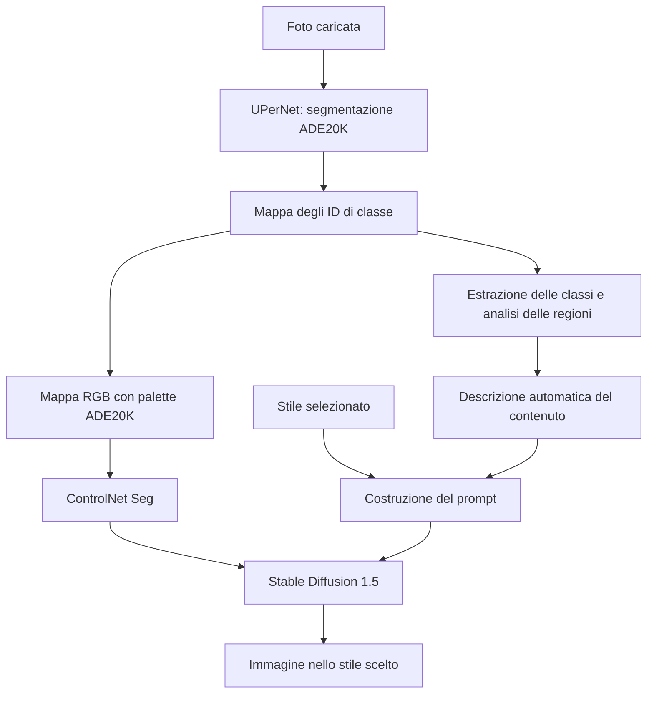

# Pipeline — Trasformazione multi-stile di paesaggi con comprensione automatica della scena

## 1. Idea e obiettivo del progetto

**Configurazione attuale:** UPerNet → classi ADE20K + mappa RGB → prompt builder
deterministico → SD + ControlNet. Il generatore riceve il prompt testuale e
l'immagine segmentata. I percorsi con modello linguistico e builder ibrido sono
stati rimossi, insieme ai relativi test e all'input strutturato dedicato.

```python
from src.pipeline import main

main(
    image_path="test_images/paesaggio-1024x683.png",
    style="Cyberpunk",
    automatic_prompt=True,
)
```

`automatic_prompt=False` seleziona la baseline con solo stile. Non è più previsto
il parametro `prompt_backend`. Vengono salvati mappa RGB, prompt `.txt` e immagine
generata; non vengono più prodotti file JSON per scene o risposte linguistiche.

Il progetto vuole trasformare una fotografia di un paesaggio in uno stile visivo selezionato, ottenendo un output il più fedele possibile al contenuto e alla composizione dell'input. L'utente deve compiere soltanto due azioni: **caricare una foto e scegliere uno stile**. La descrizione del contenuto viene ricavata automaticamente dal sistema e usata per costruire il prompt del generatore.

Gli stili iniziali da sperimentare sono Cyberpunk, GTA V, Mario Kart e Studio Ghibli. Il risultato atteso è una reinterpretazione della scena originale: per esempio, un paesaggio con montagne, vegetazione e acqua deve conservare questi elementi anche quando assume un'estetica Cyberpunk.

La domanda di ricerca principale è:

> Quanto può migliorare la fedeltà di un paesaggio generato rispetto alla fotografia originale se il prompt di SD + ControlNet viene costruito automaticamente dall'immagine, lasciando all'utente soltanto la scelta della foto e dello stile?

Il campo di lavoro attuale comprende paesaggi naturali, rurali, urbani e misti: montagne, laghi, coste, foreste, deserti, ambienti innevati, campagne, borghi e panorami cittadini. Ritratti, foto di gruppo, interni e immagini centrate su un singolo soggetto sono fuori dall'ambito di questa fase. La generalizzazione a paesaggi diversi rimane da verificare sperimentalmente.

Sono ammesse persone sullo sfondo, come elementi secondari della scena. La loro presenza non richiede di scartare la foto né di cancellarne le regioni dalla segmentation map. La conservazione dell'identità, dei tratti del viso o del colore dei capelli non è un obiettivo di questa fase: tali caratteristiche non sono codificate dalla sola classe semantica `person`.

Per **fedeltà all'input** intendiamo mantenere gli elementi riconoscibili, la loro posizione, le proporzioni delle regioni e i profili principali, come montagne, coste e skyline. Colori, texture e illuminazione possono cambiare per esprimere lo stile, senza sostituire il contenuto della scena. Anche nei paesaggi la mappa delle classi non codifica tutti i dettagli visivi della foto: il prompt automatico è un primo miglioramento da misurare, non una garanzia di ricostruzione esatta.

## 2. Punto di partenza: una baseline promettente

Nella conversazione di progetto sono stati discussi risultati preliminari ottenuti con UPerNet, segmentazione ADE20K, ControlNet e Stable Diffusion 1.5.

Dopo la correzione della palette, il confronto sul paesaggio ha suggerito che il testo influenza anche l'interpretazione delle regioni: un prompt contenente “cyberpunk street scene” favoriva una scena urbana; una descrizione coerente con montagne, foresta e lago dava un risultato più vicino al contenuto originale. Sono osservazioni qualitative riportate nella chat, non ancora una valutazione sistematica.

**SD + ControlNet costituisce quindi la baseline da cui partire.** Il passo successivo è automatizzare la descrizione che finora abbiamo dovuto scrivere a mano e misurare se questo migliora i risultati rispetto al solo nome dello stile.

La presenza di capacità stilistiche nel modello pretrained cambia il ruolo delle LoRA: il loro beneficio deve essere dimostrato. Il progetto si concentra anzitutto sulla conservazione del contenuto durante il cambio di stile.

## 3. Architettura proposta



La stessa segmentazione alimenta due percorsi complementari. La mappa RGB continua a fornire il condizionamento spaziale a ControlNet; gli ID delle classi permettono di ricavare una descrizione testuale per Stable Diffusion. Cambiando stile sulla stessa foto, si possono riutilizzare segmentazione e analisi del contenuto.

| Componente | Responsabilità |
| --- | --- |
| UPerNet | Assegnare una classe semantica ai pixel della foto |
| Analisi delle classi | Ricavare quali elementi sono presenti e la loro distribuzione nell'immagine |
| Costruttore del prompt | Combinare contenuto rilevato e stile scelto |
| ControlNet Seg | Condizionare la generazione con la mappa semantica |
| Stable Diffusion 1.5 | Generare l'immagine a partire dai condizionamenti |
| Eventuale adattamento addestrato | Migliorare un limite misurato nella conservazione del contenuto o nella resa dello stile |

## 4. Estrazione automatica del contenuto

### Prima versione: riutilizzare le classi di UPerNet

Il primo prototipo proposto non richiede un ulteriore modello di captioning. Può partire dagli ID già disponibili tramite `SemanticSegmentor.process_labels()`:

1. Calcolare una sola volta la mappa degli ID ADE20K.
2. Estrarre gli ID presenti e il numero di pixel per ciascuna classe.
3. Convertire gli ID nei nomi contenuti in `model.config.id2label`.
4. Normalizzare i nomi, eliminando sinonimi duplicati e descrizioni troppo lunghe.
5. Selezionare le classi rilevanti e costruire una descrizione breve e deterministica.
6. Colorare la medesima mappa degli ID con la palette ADE20K per ControlNet.

La selezione può usare la percentuale di area occupata da ciascuna classe. La soglia va scelta su immagini di sviluppo: una soglia troppo alta rischia di eliminare elementi piccoli ma importanti per il paesaggio, come un edificio isolato o una sottile regione d'acqua. Il filtraggio riguarda la descrizione testuale; la mappa di controllo mantiene tutte le classi rilevate, incluse eventuali persone sullo sfondo. Area occupata e confidenza della predizione sono informazioni diverse e non vanno confuse.

Esempio illustrativo, valido se quelle classi sono effettivamente rilevate:

```text
Classi: sky, mountain, tree, water
Stile: Cyberpunk

Prompt automatico:
"a scene containing sky, mountains, trees and water, cyberpunk style"
```

Il sistema deve rispettare ciò che ha osservato. La classe `water` da sola non dimostra che si tratti di un lago; `tree` non dimostra necessariamente la presenza di una foresta. Una descrizione più specifica richiede ulteriori evidenze.

### Seconda versione: aggiungere relazioni spaziali

Dalle regioni si possono ricavare area, bounding box e posizione nell'immagine. Un'estensione potrà produrre espressioni come “sky in the upper part” o “water in the lower part”.

La posizione bidimensionale non basta a stabilire profondità o relazioni complesse: “in basso” non equivale automaticamente a “in primo piano”. Questa variante va confrontata con la semplice lista delle classi per capire se aggiunge informazioni utili oppure errori.

## 5. Costruzione del prompt e scelta dello stile

Il prompt viene composto internamente secondo lo schema:

```text
prompt = descrizione_automatica_del_contenuto + descrittore_dello_stile
```

Per il primo confronto sperimentale si useranno descrittori semplici:

| Scelta dell'utente | Descrittore iniziale |
| --- | --- |
| Cyberpunk | `cyberpunk style` |
| GTA V | `GTA V style` |
| Mario Kart | `Mario Kart style` |
| Studio Ghibli | `Studio Ghibli style` |

I descrittori non devono aggiungere oggetti o ambienti obbligatori, come strade o piste, quando questi non provengono dall'analisi della foto. La descrizione deve inoltre rientrare nel limite del text encoder: selezione e sintesi delle classi dovranno evitare troncamenti non controllati.

L'interfaccia prevista mostra foto, selettore dello stile e comando di generazione. Prompt costruito, classi rilevate e mappa semantica possono essere consultabili per il debug, senza richiedere interventi dell'utente. Seed e parametri sperimentali restano nella configurazione interna.

## 6. Cosa è già implementato e cosa manca

| Parte | Stato attuale |
| --- | --- |
| `src/segmentation.py` | UPerNet `openmmlab/upernet-convnext-small`; ID ADE20K 0–149 tramite `process_labels()`; mappa RGB tramite `process()`; palette ufficiale e modalità di valutazione |
| `src/pipeline.py` | SD 1.5 + `lllyasviel/sd-controlnet-seg`, scheduler UniPC, mappa ridimensionata con NEAREST, prompt automatico o baseline di solo stile |
| `src/prompt_builder.py` | Estrazione di nomi e aree, selezione delle classi e costruzione deterministica del prompt |
| Relazioni spaziali | Non incluse nel builder attuale |
| Interfaccia foto + stile | Da implementare |
| Valutazione sistematica e training | Da progettare ed eseguire |

La pipeline attuale usa `StableDiffusionControlNetPipeline`: genera da testo e mappa di controllo. La fotografia non viene usata direttamente come immagine iniziale dei latenti di diffusione; il parametro `image` del nostro wrapper serve a ricavare le dimensioni finali. Il termine “trasformazione della foto” descrive l'obiettivo del sistema, mentre il meccanismo corrente è una generazione condizionata dalla segmentazione.

Attualmente la generazione avviene a 512 × 512 e l'output viene riportato alle dimensioni originali. Questo preprocessing può deformare immagini non quadrate; deve rimanere identico nei confronti iniziali. Una gestione delle proporzioni potrà essere valutata separatamente.

## 7. Esperimenti per verificare l'idea

### Confronto principale: origine della descrizione

| Variante | Prompt del generatore | Scopo |
| --- | --- | --- |
| A — Baseline | Solo stile | Misurare cosa preserva già SD + ControlNet |
| B — Riferimento manuale | Descrizione della foto scritta a mano + stesso stile | Valutare l'utilità di una descrizione coerente |
| C — Metodo proposto | Classi rilevate automaticamente + stesso stile | Misurare il beneficio dell'automazione |
| D — Estensione | Classi e relazioni spaziali + stesso stile | Valutare il contributo delle relazioni |

Per ogni foto si mantengono identici segmentation map, checkpoint, scheduler, seed, risoluzione e parametri; cambia soltanto la costruzione del prompt. B è un riferimento sperimentale e non fa parte dell'interfaccia finale.

L'ipotesi è che C migliori la conservazione del contenuto rispetto ad A e si avvicini a B. È un'ipotesi da verificare, non un risultato acquisito.

Si propone una prima raccolta esplorativa di 10–20 paesaggi eterogenei, provati nei quattro stili. Includere montagne e laghi, coste, foreste, campagne, deserti, neve, borghi e panorami urbani, con composizioni e proporzioni diverse. Scegliere scene in cui il paesaggio è il soggetto principale; eventuali persone devono rimanere secondarie. Per il debug si parte dai parametri già concordati:

```python
seed = 42
num_inference_steps = 20
guidance_scale = 7.5
controlnet_conditioning_scale = 1.0
```

Successivamente si ripete il confronto con più seed condivisi tra le varianti e un insieme di test separato dalle immagini usate per scegliere soglie e template. Vanno salvati input, ID, mappa RGB, classi selezionate, prompt completo, output e configurazione dell'esperimento. Lo stesso seed non garantisce risultati identici tra hardware e versioni software diverse.

### Ruolo del condizionamento strutturale

A prompt fissato, confrontare `controlnet_conditioning_scale` pari a `0.0`, `0.5`, `1.0` e `1.5`. Il valore zero annulla il contributo di ControlNet, ma un eventuale prompt automatico continua a trasportare informazioni ricavate dalla foto. Questo confronto isola quindi il contributo della mappa, non quello di tutta l'analisi dell'immagine.

### Test di fedeltà dei paesaggi

Per ogni paesaggio annotare prima della generazione gli elementi da conservare e le loro relazioni visibili. Per esempio, in una foto con montagne, vegetazione e lago: profilo montuoso nella parte superiore, fascia di alberi al centro e superficie d'acqua nella parte inferiore. Nei panorami urbani controllare skyline, masse degli edifici, strade e vegetazione.

Confrontare A/B/C verificando sostituzioni di contenuto, elementi inventati o scomparsi, spostamenti delle regioni e alterazioni dei profili principali. Le annotazioni servono alla valutazione e al riferimento manuale B; non devono entrare nel prompt automatico C. Il test centrato sulle quattro persone è rinviato fuori da questa fase. Le persone di sfondo possono essere annotate come elementi secondari, senza valutazioni di identità o caratteristiche fisiche.

## 8. Valutazione e criteri di successo

La conservazione del contenuto e la fedeltà allo stile vanno valutate separatamente. Un risultato stilisticamente convincente può comunque aver sostituito il lago con una strada.

| Aspetto | Valutazione prevista |
| --- | --- |
| Presenza del contenuto | Elementi conservati, mancanti e aggiunti, verificati rispetto alla foto |
| Disposizione spaziale | Confronto delle mappe semantiche, anche tramite mIoU, e controllo visivo |
| Profili e proporzioni del paesaggio | Conservazione di orizzonte, profili montuosi, coste, skyline ed estensione relativa delle regioni |
| Fedeltà allo stile | Valutazione umana con criteri comuni e riferimenti visivi coerenti |
| Utilità del sistema | Nessun prompt manuale richiesto, tempi di elaborazione e frequenza dei fallimenti |

La segmentazione delle immagini stilizzate può essere meno affidabile di quella delle foto: una metrica basata sulle mappe non costituisce da sola una prova di conservazione. Occorre controllare i casi di errore e affiancare verifiche umane; quando possibile, usare un valutatore indipendente dal segmentatore che produce il conditioning.

Il metodo sarà utile se migliorerà sistematicamente la conservazione del contenuto rispetto alla baseline, mantenendo una resa riconoscibile dello stile. Vanno riportati anche i casi in cui il prompt automatico peggiora il risultato, distinguendo errori di segmentazione, descrizione e generazione.

## 9. Ruolo delle LoRA e contributo di Deep Learning

La prima versione proposta riutilizza modelli pretrained e aggiunge un modulo di analisi e costruzione del prompt. È un contributo di sistema da validare sperimentalmente; non rappresenta, da solo, un nuovo modello addestrato.

Se il progetto richiede una componente di training, questa dovrà affrontare un limite emerso dagli esperimenti. Due possibili direzioni sono:

- **Adattamento dello stile:** una LoRA per un dominio visivo specifico, confrontata con il medesimo sistema senza LoRA. Bisogna controllare che il training non introduca oggetti o scene tipici del dataset in foto che non li contengono.
- **Adattamento per conservare il contenuto:** un modulo addestrabile che migliori l'uso delle informazioni semantiche durante la trasformazione. Architettura, dati, obiettivo di training e baseline devono essere definiti prima dell'implementazione.

Una loss che combini diffusione, contenuto e stile è al momento soltanto una possibile direzione. Servono segnali di supervisione concreti e un percorso di ottimizzazione definito: non basta aggiungere formalmente una metrica semantica alla loss.

Le LoRA saranno introdotte se apporteranno un vantaggio misurabile. Il loro caricamento dinamico potrà permettere di condividere il backbone tra più stili, ma non è un requisito del primo prototipo.

## 10. Prossimi passi

Il prossimo obiettivo è ottenere questo flusso completo:

**Foto del paesaggio + stile → analisi automatica → prompt + segmentation map → immagine generata.**

Procederei in questo ordine:

1. **Preparare le immagini di prova.**  
   Partiamo dal paesaggio con montagne e lago già disponibile, poi aggiungiamo 10–20 foto di coste, foreste, campagne, deserti, neve e panorami urbani. Il paesaggio deve essere il soggetto principale.

2. **Estrarre le informazioni dalla segmentazione.**  
   Estendiamo `segmentation.py` per restituire, con una sola elaborazione:
   - mappa degli ID;
   - mappa RGB per ControlNet;
   - nomi delle classi rilevate e percentuale occupata nell’immagine.

3. **Creare `prompt_builder.py`.**  
   Il modulo selezionerà le classi rilevanti e le combinerà con lo stile:
   ```text
   a landscape containing mountains, trees, water and sky, cyberpunk style
   ```
   Inizialmente usiamo le sole classi, evitando dettagli o relazioni non ricavati dall’immagine.

4. **Integrare tutto in `pipeline.py`.**  
   Impostiamo foto e stile come input; il prompt viene costruito internamente. Salviamo immagine generata, mappa, classi, prompt e parametri per rendere ogni prova confrontabile.

5. **Confrontare tre modalità.**

   | Modalità | Descrizione del contenuto |
   |---|---|
   | Baseline | Nessuna: solo stile |
   | Riferimento manuale | Scritta da noi |
   | Metodo automatico | Estratta dalla segmentazione |

   A parità di foto, mappa, seed e parametri, controlliamo elementi conservati, disposizione, proporzioni e profili del paesaggio, insieme alla resa dello stile. Partiamo da Cyberpunk, poi estendiamo agli altri stili.

6. **Decidere il miglioramento successivo.**  
   Dai risultati capiremo se serve arricchire la descrizione, migliorare il condizionamento strutturale o introdurre un adattamento addestrato. Le LoRA verranno valutate quando avremo identificato il problema specifico da risolvere.
