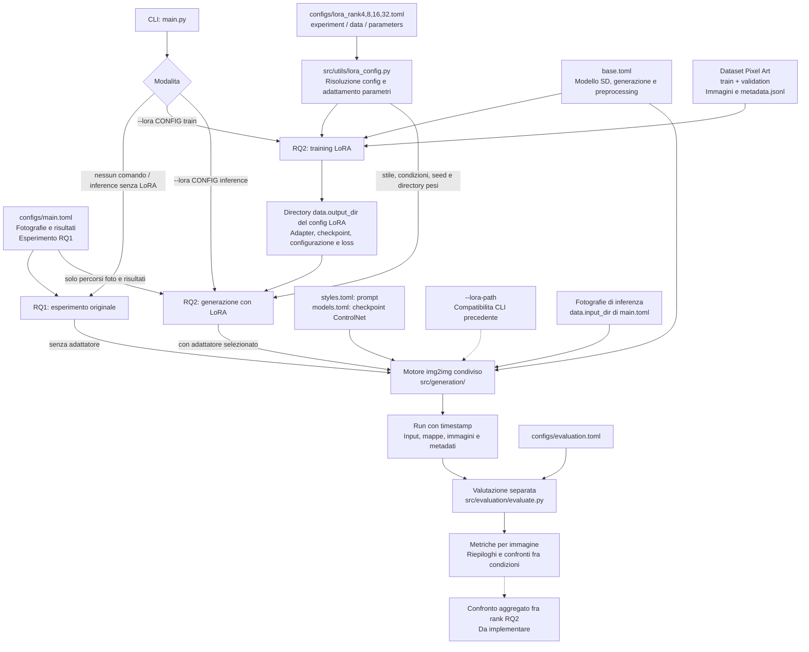
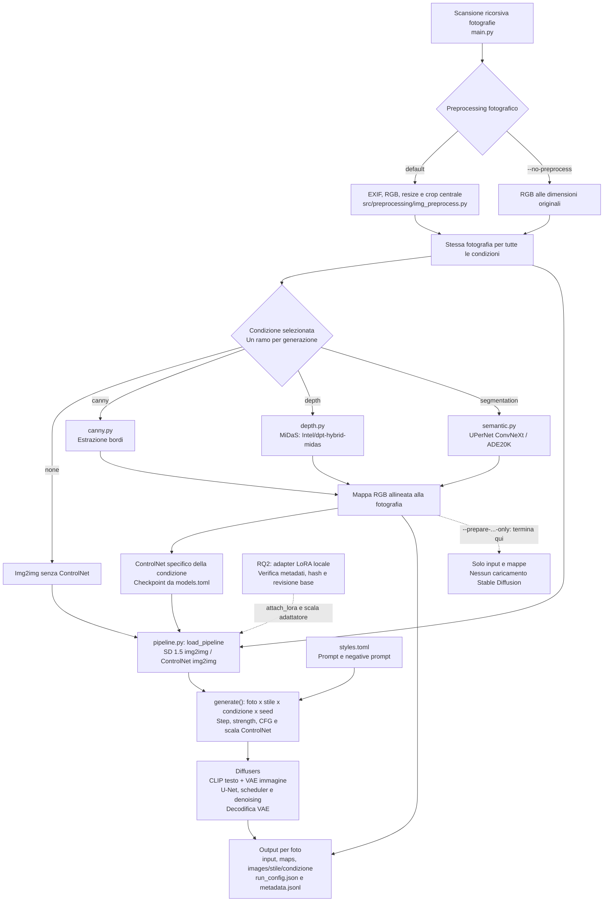
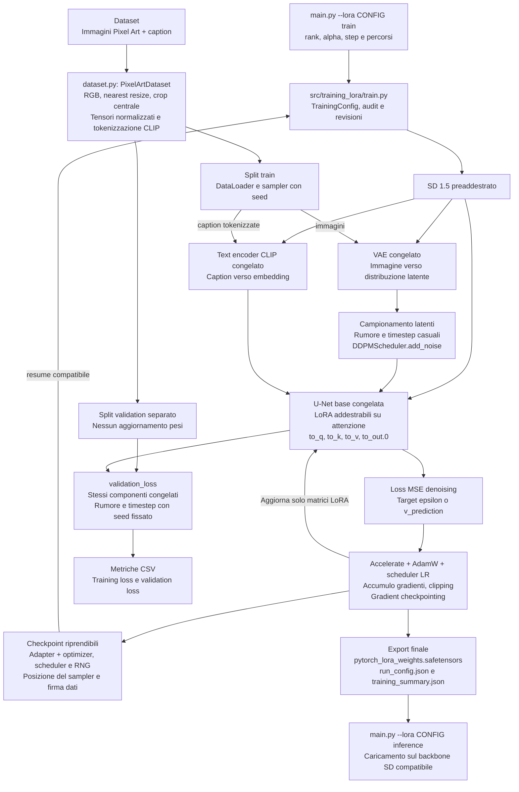
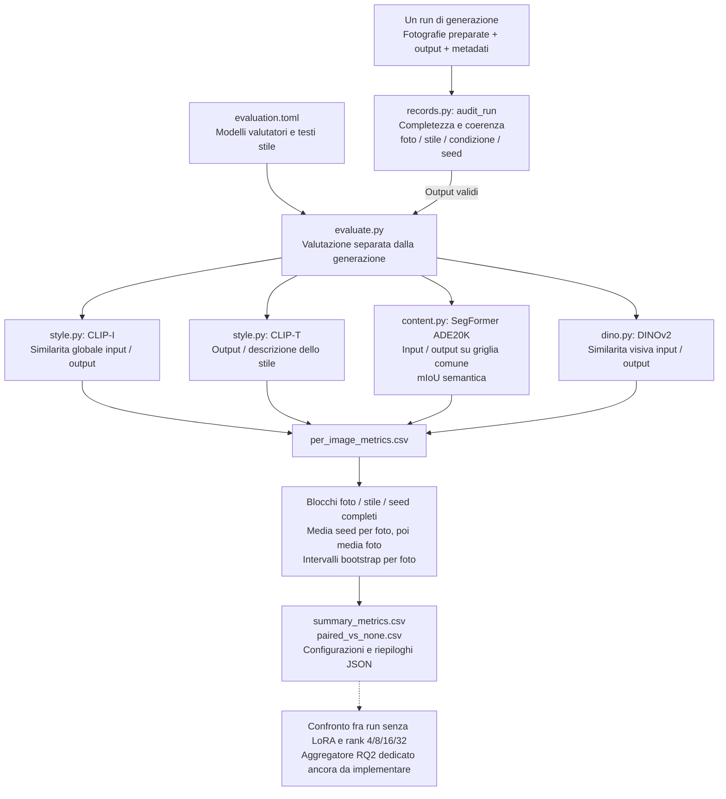

# Architettura del progetto — RQ1 e RQ2

Riferimento al codice attuale, 10 novembre 2026. RQ1 e RQ2 condividono il
motore di generazione img2img. RQ2 aggiunge il training degli adattatori LoRA
e il loro caricamento opzionale; i componenti di training e inferenza restano
separati. Le frecce tratteggiate indicano contributi opzionali o una fase
esplicitamente ancora da implementare.

Per protocollo e stato aggiornato dei rank vedere [RQ2_PIXEL_ART.md](RQ2_PIXEL_ART.md).
I quattro rank 4/8/16/32 sul dataset corrente sono completati e verificati;
il pilota rank 8 storico usa un'altra selezione e resta distinto. Vedere
il [resoconto RQ2](../Resoconto_RQ2.md). Il dataset runtime e in `data/pixel_art/` (360/40),
la descrizione e l'inventario in [Dataset_LoRA.md](../../data/pixel_art/Dataset_LoRA.md).

## 1. Vista complessiva e configurazioni



`src/utils/config.py` carica e valida l'esperimento di generazione. In RQ2
sostituisce soltanto la sezione `experiment` con quella del config LoRA:
foto e risultati rimangono quelli di `main.toml`. Per il training,
`data.input_dir` del config LoRA e invece il dataset e `data.output_dir`
e la directory dei pesi. `parameters` viene tradotta nella CLI del trainer.
Il seed di training e il primo di `experiment.seeds`, salvo `parameters.seed`.

Il CSV di selezione e i manifest del dataset descrivono costruzione e
provenienza: il trainer carica direttamente gli split e i loro metadata.
Le fotografie usate per i test di inferenza costituiscono un insieme distinto.

## 2. Generazione condivisa: RQ1 e inferenza RQ2



Le condizioni vengono eseguite separatamente: il codice non combina Canny,
depth e segmentation in un Multi-ControlNet. La fotografia preparata e
condivisa; il modello di preprocessing appreso viene liberato prima di
caricare la pipeline di generazione. Si carica una pipeline per condizione
e fotografia, riutilizzandola per gli stili e i seed di quella condizione.

RQ1 usa gli stili di `main.toml`, attualmente GTA V, Pixel Art e Watercolor,
senza LoRA. In RQ2 viene caricato un adattatore per run e un solo stile.
La condizione `none` con LoRA significa **senza ControlNet, con LoRA attivo**;
la baseline senza adattatore richiede un run separato.

L'inferenza usa il device e la precisione indicati in `base.toml` e lo
scheduler del checkpoint caricato. I flag di preparazione salvano input e
mappe senza Stable Diffusion. Il seed e ricreato per ogni generazione.

## 3. Training RQ2: componenti congelati e parametri aggiornati



Il training non usa fotografie di test, mappe ControlNet o metriche di stile.
La validation loss misura il denoising su dati separati; non dimostra da sola
la qualita del trasferimento Pixel Art.

Nella revisione locale a 400 immagini lo split e 360 train / 40 validation.
I default del trainer sono risoluzione 512, batch 1, accumulo 4, AdamW con
learning rate 1e-4, 1000 aggiornamenti e seed 42. I config rank impostano
alpha uguale al rank. VAE ed embedding testuali vengono ancora calcolati a
ogni batch: non e implementata una cache dei latenti o degli embedding.

Accelerate sceglie automaticamente CUDA, MPS o CPU. L'implementazione attuale
usa FP32 su MPS/CPU e applica la mixed precision richiesta su CUDA. Questo
comportamento e separato dalla scelta del device per la generazione.

## 4. Valutazione delle immagini e confronto degli esperimenti



CLIP-I e DINO-I misurano similarita visiva, CLIP-T l'allineamento al testo
di valutazione dello stile: non sono percentuali di qualita. SegFormer e
un valutatore distinto dall'UPerNet usato per il conditioning.

Il comando di evaluation opera su **un singolo run** ed e separato dal main.
Le metriche sono riutilizzabili sugli output RQ2, ma i riepiloghi esistenti
confrontano le condizioni con `none` all'interno di quel run. Se il run usa
un LoRA, anche `none` usa quel LoRA: `paired_vs_none.csv` non e quindi un
confronto contro il modello senza adattatore.

Il confronto automatico appaiato fra rank, con controlli espliciti su dataset,
training e LoRA, non e ancora implementato: `src/evaluation/lora_eval.py`
e attualmente vuoto. Il ramo tratteggiato rappresenta questo lavoro futuro.
Il device automatico dell'evaluator seleziona CUDA oppure CPU, non MPS.

## Comandi di accesso ai flussi

```bash
# RQ1: esperimento configurato, senza adattatore
python3 main.py

# RQ2: training, con percorso locale del dataset
python3 main.py --lora lora_rank4.toml train --dataset-dir data/pixel_art

# RQ2: inferenza con i pesi del rank selezionato
python3 main.py --lora lora_rank4.toml inference

# Valutazione separata di un run
python3 -m src.evaluation.evaluate --run-dir outputs/NOME_RUN
```

I config non vengono riscritti. Per gli altri rank cambia il nome del TOML.
Il dataset attuale e in `data/pixel_art`, come indicato nei TOML. La
directory contiene i due split con immagini e metadata e il documento
`Dataset_LoRA.md` con fonti e selezione. Le fotografie di inferenza
rimangono quelle configurate in `main.toml`.
